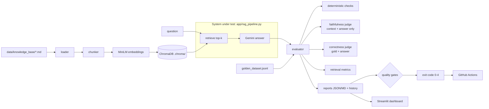
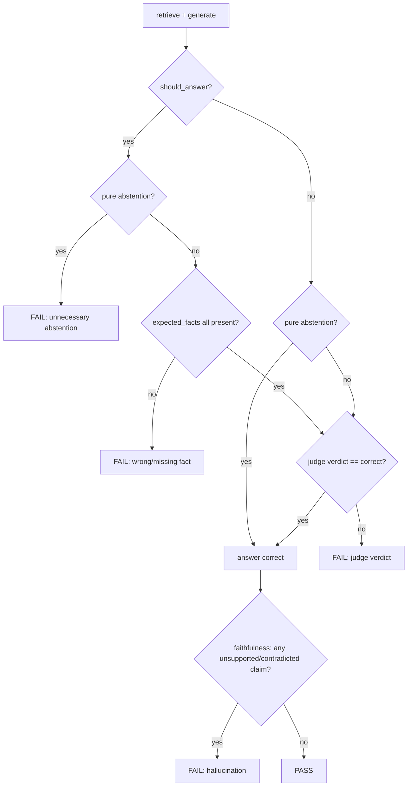

# EvalForge

**Automated evaluation and CI quality gates for a RAG (retrieval-augmented generation) application.**

EvalForge tests an LLM application the way conventional software is tested. It runs a 110-case golden dataset through a real RAG pipeline (local embeddings, ChromaDB and Google Gemini), then scores each answer for correctness, relevance, faithfulness to the retrieved context, retrieval quality, latency and cost. The results go into JSON/Markdown reports, and the quality gates fail the build with a meaningful exit code.

---

## 1. The problem

Unit tests can check deterministic functions. LLM applications fail in other ways:

| Failure mode | Example | How EvalForge catches it |
|---|---|---|
| Confident but wrong | "Refunds within **30** days" (policy says 7) | Deterministic fact checks + LLM judge |
| Unsupported claims | Inventing an international-shipping policy | Claim-level faithfulness judge |
| Not abstaining | Answering a question the documents cannot answer | 36 unanswerable cases + abstention accuracy |
| Over-abstaining | "I don't have enough information" when the answer exists | Unnecessary-abstention check |
| Bad retrieval | The right document never reaches the model | Source hit rate / precision / recall / MRR |
| Regressions | A prompt or model change lowers accuracy | Pinned baseline + regression gate |
| API instability | HTTP 503 / 429, bad key, unknown model | Retries, error classification, "incomplete" status (never a pass) |
| Cost/latency drift | Thinking tokens double the cost | Token usage, cost estimate, p95 latency gate |

## 2. Architecture



### Evaluation flow for one case



A *pure abstention* is an answer that consists only of the prompt's sentence "I don't have enough information to answer that." An answer that uses that sentence **and** adds content ("…the policy only says X") is graded by the judge in both directions, because it may be the right nuanced answer or may hide an invented detail.

An API or judge error at any step gives the case status **error**. An error is never counted as a pass, and never as a quality failure either.

## 3. Repository structure

```
app/
  config.py            paths, models, retry settings, quality-gate thresholds
  loader.py            loads data/knowledge_base/*.md
  chunker.py           character chunker (default) + paragraph chunker (experiment)
  embedder.py          all-MiniLM-L6-v2, loaded lazily
  vector_store.py      ChromaDB at .chroma/, idempotent sync, search
  ingestion.py         load -> chunk -> embed -> store, records index config
  rag_pipeline.py      THE system under test: retrieve() + generate_answer()
  gemini_client.py     Gemini SDK wrapper: retries, backoff, error classes, token usage; provider selection
  groq_client.py       Groq (OpenAI-compatible) client with the same retry/error policy
  dataset.py           golden dataset schema + validation (file:line errors)
  metrics.py           fact checks, abstention, retrieval metrics, percentiles
  judge.py             LLM-as-a-judge (faithfulness, correctness/relevance)
  pricing.py           verified Gemini prices -> cost estimates
  evaluator.py         per-case evaluation, failure isolation, aggregation
  quality_gates.py     gates + exit-code policy
  report_generator.py  JSON/Markdown reports, history, baseline
  errors.py            exception hierarchy
scripts/
  ingest.py               build/sync the vector store
  validate_dataset.py     validate the golden dataset
  run_eval.py             live evaluation (main entry point)
  retrieval_experiment.py compare chunking/top-k offline
  test_*.py               original manual smoke scripts (call the real model/API)
dashboard/streamlit_app.py   read-only dashboard over reports/
data/golden_dataset.jsonl    110 golden cases
data/knowledge_base/         refund, shipping and account policies
tests/                       offline pytest suite (fakes, no API key)
tests/live/                  live API tests (opt-in: pytest -m live)
.github/workflows/evalforge.yml
```

## 4. Technology stack

Python 3.12, `google-genai` (Gemini) or Groq's OpenAI-compatible API via `httpx`, `sentence-transformers` (`all-MiniLM-L6-v2`), ChromaDB, NumPy, python-dotenv, Streamlit + pandas (dashboard), pytest + ruff (development), GitHub Actions. All versions are pinned in `requirements.txt` and `requirements-dev.txt`.

## 5. Setup (Windows PowerShell)

Prerequisites: Python 3.12 and Git. You only need a Gemini API key for the live evaluation; everything else runs without one.

```powershell
git clone <your-repo-url> evalforge
cd evalforge
py -3.12 -m venv .venv
.\.venv\Scripts\Activate.ps1          # if blocked: Set-ExecutionPolicy -Scope CurrentUser RemoteSigned
python -m pip install --upgrade pip
pip install -r requirements-dev.txt   # runtime + pytest + ruff
Copy-Item .env.example .env           # then edit .env and paste your key
```

macOS/Linux: `python3.12 -m venv .venv && source .venv/bin/activate`, then the same pip commands, and `cp .env.example .env`.

### Secure configuration

`.env` (git-ignored) holds `GEMINI_API_KEY`. Get a key from Google AI Studio. Never commit `.env`, and never paste the key into code, tests, reports or workflow files. In GitHub, store it as a repository secret (see section 10). Reports never include environment variables, and a test (`test_reports_never_contain_the_api_key`) enforces this.

Optional settings in `.env`: `GEMINI_MODEL` (default `gemini-3.6-flash`), `JUDGE_MODEL`, `TOP_K`, `CHUNK_STRATEGY`, `GEMINI_MAX_RETRIES`, `GEMINI_RETRY_BASE_DELAY_S`, `GEMINI_RETRY_MAX_DELAY_S`, `GEMINI_REQUEST_TIMEOUT_S`, `GEMINI_MIN_REQUEST_INTERVAL_S`, `MAX_CONSECUTIVE_INFRA_FAILURES`, `JUDGE_MAX_FORMAT_RETRIES`.

## 6. Commands

Run all commands from the repository root with the virtual environment active. Use `python -m scripts.X`, not `python scripts\X.py`: the module form puts the repo root on the import path.

| Purpose | Command | API key? |
|---|---|---|
| Validate the dataset | `python -m scripts.validate_dataset` | No |
| Build/sync the vector store | `python -m scripts.ingest` (first run downloads MiniLM, ~90 MB) | No |
| Rebuild the store from scratch | `python -m scripts.ingest --rebuild` | No |
| Offline test suite | `python -m pytest` | No |
| Lint | `ruff check .` | No |
| Retrieval experiment | `python -m scripts.retrieval_experiment` | No |
| Live smoke run (5 cases) | `python -m scripts.run_eval --limit 5` | **Yes** |
| Full live evaluation | `python -m scripts.run_eval` | **Yes** |
| Pin a run as baseline | `python -m scripts.run_eval --update-baseline` | **Yes** |
| Live API tests | `python -m pytest -m live` | **Yes** |
| Dashboard | `streamlit run dashboard/streamlit_app.py` | No |

Filters for `run_eval`: `--ids q001,q017`, `--category refund`, `--limit N`, `--top-k K`.

**When to run ingestion:** after cloning, and again whenever a knowledge-base file or a chunking setting changes. It is idempotent. Re-running it updates edited chunks (using upsert; a plain `add` silently keeps stale text), removes chunks of deleted files, and changes nothing when the inputs are unchanged. `--rebuild` drops and recreates the collection. The store lives at `.chroma/` (absolute path from `app/config.py`), so it is never committed and never depends on your current directory.

### Cost and time of a full run

Each case makes 3 Gemini calls (1 answer + 2 judge calls), so the full dataset makes about 330 requests. **The free tier allowed only 20 requests per day for `gemini-3.6-flash` when tested (2026-10-26), so a full run with that model needs a paid-tier key.** Flash-Lite models have a much higher free daily limit (reported as 500 requests/day for `gemini-3.5-flash-lite`), so a full free run is possible by choosing that model in the workflow's *model* box (or `GEMINI_MODEL=gemini-3.5-flash-lite`). Results then describe Flash-Lite, not the default model, and are not comparable to Flash runs. At the measured cost of about $0.0047 per case including judge calls, that is roughly $0.50 per full run. The report records the actual token counts and estimated cost. Free-tier rate limits vary by account (see Google AI Studio). If you hit HTTP 429 errors, set `GEMINI_MIN_REQUEST_INTERVAL_S` (e.g. `6` for about 10 requests per minute), or run by category or `--limit` first.

## 7. Exit codes

| Code | Meaning |
|---|---|
| 0 | Evaluation completed; all quality gates passed |
| 1 | Evaluation completed; at least one quality gate failed |
| 2 | Invalid configuration or dataset (no key or placeholder key, bad env value such as `TOP_K=abc`, empty store, malformed JSONL, unknown `--ids`, model download failed) |
| 3 | **Incomplete**: Gemini API errors, empty/blocked responses or malformed judge output stopped some cases; the run is not a pass (`gates_passed` is false) |
| 4 | Evaluation-engine error (an unexpected exception in EvalForge code; the traceback is printed, and per-case tracebacks are in the JSON report) |

If several conditions apply, the most fundamental one wins: 4 > 2 > 3 > 1 > 0.

## 8. Reports

| File | Content |
|---|---|
| `reports/latest_report.json` | Everything: config, per-case records (answer, retrieved chunks with rank/distance, fact checks, judge verdicts, claims, latency, tokens, cost, errors), aggregates, gates |
| `reports/latest_report.md` | Human-readable summary: outcome, gates, metrics with sample sizes, failed cases with reasons, errors, where to investigate, limitations |
| `reports/history.jsonl` | One summary line per run (append-only) |
| `reports/baseline.json` | Pinned baseline for the regression gate. Created only by `--update-baseline` (none exists yet). Commit it so CI can use it; `.gitignore` already allows this file |
| `reports/retrieval_experiment.json` | Output of the retrieval experiment |

Each report records `run_mode`. Real runs say `live`; the reports that tests generate say `test-fake`, and the dashboard warns about any non-live report.

## 9. Metrics: definitions

These metrics measure different things and are not interchangeable.

| Metric | Question it answers | How |
|---|---|---|
| **Answer correctness** | Does the answer match the reference answer? | Deterministic hard checks, then an LLM judge that sees the gold answer. `answer_accuracy` = correct / completed cases |
| **Answer relevance** | Does it address the question asked (right or wrong)? | Judge `relevance_score` (0 to 1), averaged |
| **Context relevance** | Did retrieval bring the right documents? | Source precision (below) |
| **Faithfulness** | Is every claim supported by the *retrieved context*? | Faithfulness judge (never sees the gold answer) splits the answer into claims labelled supported / unsupported / contradicted. Score = supported / claims. Answers with no claims (abstentions) get no score and are excluded, with the count reported |
| **Hallucination rate** | How often does the answer contain an unsupported or contradicted claim? | Cases with ≥1 such claim / completed cases |
| **Abstention accuracy** | On unanswerable questions, does it decline instead of inventing? | Correct / completed unanswerable cases |

**Faithfulness is not truth.** A model can faithfully repeat a wrong document, and it can state a true fact that the retrieved context does not support. EvalForge measures faithfulness to retrieved evidence. Correctness is measured separately, against the human-written reference.

**Deterministic checks** (`expected_facts` in the dataset; `app/metrics.py`):
- `duration` (`7 days`, `one week`, `5–7 business days`). Business days and calendar days are kept apart.
- `count` (`5 failed attempts`, `fifth attempt`).
- `clock_time` (`6 PM`, `18:00`, `6:00 p.m.`).
- `phrase` (normalised substring, e.g. "forgot password").

A missing required fact fails the case even if the judge is lenient. Every gold answer is tested against its own checks, so a brittle check is caught in CI.

**Retrieval metrics** are source level (file names), for cases with relevance labels. With U = unique retrieved sources and R = relevant sources:
- hit = 1 if |U∩R| > 0
- precision = |U∩R| / |U|, or 0 if nothing was retrieved
- recall = |U∩R| / |R|
- reciprocal rank = 1 / rank of the first relevant chunk

Unanswerable cases have R = ∅ and are excluded rather than scored 0. Recall is never computed without labels.

**Latency** uses a monotonic clock (`time.perf_counter`).
- *Retrieval* covers query embedding plus vector search.
- *Generation* is the successful model call.
- *End-to-end* is retrieval plus generation including retry waits (what a user experiences).

Judge latency is reported separately as evaluation overhead. Percentiles use linear interpolation (same as `numpy.percentile` and Excel `PERCENTILE.INC`) and are always shown with n. Small samples give unstable percentiles.

**Semantic similarity** (MiniLM cosine to the reference, clipped to [-1, 1]) is reported as a diagnostic only. It rates "30 days" and "7 days" as very similar, so it does not decide pass/fail.

## 10. Quality gates

Configured in `app/config.py` → `QUALITY_GATES`:

| Gate | Threshold | Origin |
|---|---|---|
| answer_accuracy | ≥ 0.80 | new |
| answer_relevance (mean) | ≥ 0.70 | original `MIN_ANSWER_RELEVANCY` |
| faithfulness (mean) | ≥ 0.70 | original `MIN_FAITHFULNESS` |
| hallucination_rate | ≤ 0.20 | original `MAX_HALLUCINATION_RATE` |
| abstention_accuracy | ≥ 0.80 | new |
| source_hit_rate | ≥ 0.90 | new |
| p95 end-to-end latency | ≤ 5000 ms | original `MAX_P95_LATENCY_MS` |
| mean pipeline cost per query | ≤ $0.01 | new |
| accuracy drop vs baseline | ≤ 0.05 | new; *skipped* (with reason) if no compatible baseline |

Policies:
- A gate whose metric is unavailable **fails**.
- A gate is only *skipped* when it cannot apply, and the reason is printed. This happens in four cases:
  - abstention accuracy, when the run has no unanswerable cases;
  - faithfulness, when no answer made any claims;
  - the regression gate, when there is no compatible baseline;
  - source hit rate, when top-k is at least the number of chunks in the store, so every source is always retrieved. This is true of the current default configuration.
- A baseline is compatible only if the dataset, case selection, models, prompt, top-k and index all match.
- Only a complete run can report `gates_passed: true`.

**These thresholds are provisional.** They have not been calibrated against a live baseline yet. Calibrate them like this:
1. Run the full evaluation 2–3 times and note the run-to-run spread.
2. Set each gate at a level the product genuinely needs, and no looser than the baseline minus that spread.
3. Pin the baseline with `--update-baseline`.

Don't lower a threshold just to make a run pass.

## 11. GitHub Actions (`.github/workflows/evalforge.yml`)

- **offline-tests** runs on every push and pull request, with no secrets. It installs pinned dependencies (CPU-only PyTorch), then runs `ruff`, dataset validation and the full offline pytest suite.
- **live-evaluation** runs only when started manually (*Actions → EvalForge → Run workflow*, with optional case IDs such as `q017,q068`, an optional case limit, a provider choice (Gemini or Groq) with optional answer/judge model overrides, and a minimum interval between API requests, default 4 s, to stay under free-tier rate limits), or on pushes to `main` if the repository variable `LIVE_EVAL_ON_PUSH` is `true`. It never runs for pull requests, so forked PRs can't reach the secret. It ingests, runs `scripts.run_eval`, publishes the Markdown report to the job summary, uploads the reports as an artifact, and then fails the job with the evaluator's exit code. Because this job only runs when a live evaluation was requested, a missing secret **fails the job** ("Live evaluation NOT RUN") instead of leaving a misleading green check.

**Secret setup:** repository *Settings → Secrets and variables → Actions → New repository secret*, with name `GEMINI_API_KEY`, or `GROQ_API_KEY` when using the Groq provider. Optional: under *Variables*, add `LIVE_EVAL_ON_PUSH` = `true`.

## 12. Model and pricing

- Model: `gemini-3.6-flash`. Stable according to the [model page](https://ai.google.dev/gemini-api/docs/models/gemini-3.6-flash), checked 2026-10-26. `gemini-3.5-flash`, which this project used earlier, is deprecated and is now routed to 3.6 automatically.
- Prices (USD per 1M tokens), from [Gemini Developer API pricing](https://ai.google.dev/gemini-api/docs/pricing), verified 2026-10-26: $0.75 input / $3.75 output through 2026-12-31, then $1.50 / $7.50 from 2027-01-01. Output includes thinking tokens. `app/pricing.py` picks the price for the run date.
- Cost figures are estimates at paid Standard-tier list prices. The free tier is not billed. An unlisted model gets cost "n/a", never another model's price.

### Alternative provider: Groq

Gemini's free tier allows 20 requests per day for `gemini-3.6-flash` (observed in run #4), but a full run needs about 330. So EvalForge can also run on [Groq](https://groq.com) via `LLM_PROVIDER=groq` and `GROQ_API_KEY`. In GitHub Actions, choose **provider: groq** in *Run workflow*.

- **Models.** By default, `openai/gpt-oss-20b` answers and `openai/gpt-oss-120b` judges. Groq applies free-tier quotas per model, so each model gets its own daily budget. Judging with a different, larger model also reduces the self-grading bias listed under Limitations. Override with `GENERATION_MODEL` / `JUDGE_MODEL`.
- **Free-plan limits.** Groq's sample free-plan limits, read by benchlm.ai on 2026-10-16, are 30 requests/min, 1,000 requests/day, 8,000 tokens/min and 200,000 tokens/day per model. Exact limits for your organisation are on Groq's console limits page.
- **Prices.** Per 1M tokens: gpt-oss-20b $0.075 in / $0.30 out; gpt-oss-120b $0.15 / $0.60. These come from two independent trackers (benchlm.ai, eesel.ai), because groq.com could not be fetched from the build environment. Re-check them on groq.com/pricing.
- **Implementation.** `app/groq_client.py` calls the OpenAI-compatible Chat Completions endpoint with `httpx`, using the same retry, quota fail-fast and error-classification rules as the Gemini client. Judge calls use JSON mode, and their output is still validated by `app/judge.py`.
- **Comparability.** Results from Groq models describe those models. The compatibility key includes the provider and models, so they are never compared with Gemini baselines.

## 13. Troubleshooting

| Symptom | Cause / fix |
|---|---|
| `No module named 'app'` | Run as `python -m scripts.run_eval` from the repo root, not `python scripts\run_eval.py` |
| Exit 2 `GEMINI_API_KEY is not set` | Create `.env` from `.env.example` |
| Exit 2 `vector store is empty` | `python -m scripts.ingest` |
| Exit 2 `Could not load embedding model` | First run needs internet access to Hugging Face |
| Exit 3 with `HTTP 503 UNAVAILABLE` | Gemini overloaded; retried with backoff, then recorded. Re-run later |
| Exit 3 with `HTTP 429` (per-minute) | Rate limit: set `GEMINI_MIN_REQUEST_INTERVAL_S`, use `--limit` |
| Exit 3, "API quota exhausted" | Daily quota used up (free tier: 20 requests/day). Wait for the reset (midnight Pacific time) or enable billing in Google AI Studio |
| Exit 3/aborted with `HTTP 401/403` | Invalid key or no API access (not retried) |
| Exit 3/aborted with `HTTP 404` | Model name wrong or retired: check `GEMINI_MODEL` |
| Exit 3 `judge_failure` | Judge returned invalid JSON twice; re-run or try another `JUDGE_MODEL` |
| Exit 3 `empty_response` | Model returned no text (often a safety block) for that case; the rest of the run continues |
| `possibly_truncated_answers` > 0 in the report | The model stopped for a reason other than `STOP` (e.g. `MAX_TOKENS`); inspect `generation.finish_reason` per case |
| `Activate.ps1 cannot be loaded` | `Set-ExecutionPolicy -Scope CurrentUser RemoteSigned` |

## 14. Golden dataset

`data/golden_dataset.jsonl` holds 110 cases: 74 answerable and 36 unanswerable, across refund, shipping, account, cross-policy and out-of-scope questions.

- Cases are tagged by type: paraphrase, numeric, condition, exception, ambiguous, false premise, multi-source, retrieval trap, near miss, adversarial.
- The original `q001`–`q003` are unchanged; they only gained the optional fields.
- Required fields are the original six: `id`, `question`, `expected_answer`, `expected_source`, `category`, `difficulty`.
- Optional fields: `should_answer`, `relevant_sources`, `expected_facts`, `tags` (documented in `app/dataset.py`).
- Answers come only from the three policy files. Unanswerable cases expect the prompt's own abstention sentence.
- Cases tagged `partial` or `ambiguous` (e.g. q011, q067) are labelled answerable because the policy says *something* relevant. The expected answer states that part and acknowledges what the policy does not cover. A pure "I don't have enough information" fails these cases; a nuanced answer is graded by the judge.

## 15. Limitations

- The knowledge base is tiny: 3 documents of about 350 characters each. With the default 500-character chunks, each document is one chunk. With top-k = 3, every query retrieves every document, so the source hit rate is trivially 100% and precision is about 0.33. This also explains the early observation that "a refund question retrieved account and shipping documents". `scripts/retrieval_experiment.py` compares this with paragraph chunking and smaller k on the unchanged dataset. Any switch should be made from that evidence (`CHUNK_STRATEGY=paragraph`, `TOP_K=…`, then re-ingest).
- The LLM judge can be wrong. By default it is the same model as the system under test (possible self-preference bias), and it is not deterministic. Its verdicts, issues and claim lists are stored per case so false positives and negatives can be audited.
- Generation is not deterministic, so repeated runs differ. Calibrate gates on several runs.
- Source-level retrieval metrics can't tell which chunk of a relevant file was retrieved.
- Offline tests use a fake embedder and a fake LLM. They verify the evaluation *logic*, not real model quality.

## 16. Verified status

| Item | Status | Evidence |
|---|---|---|
| Offline suite (218 tests) | ✅ passes on Python 3.12.13 and 3.13 | `python -m pytest` |
| Independent code review | ✅ 12 confirmed findings fixed, each with a regression test | see git history |
| Lint, workflow syntax | ✅ | `ruff check .`, `actionlint` |
| Dataset (110 cases) | ✅ valid | `python -m scripts.validate_dataset` |
| Dashboard | ✅ starts, renders with/without reports | `streamlit run …`, AppTest tests |
| Exit codes 0/1/2/3/4, regression demo | ✅ (with fakes; exit 2 also as a real process) | `tests/test_quality_gates_cli.py` |
| Offline CI on GitHub | ✅ green (run #1) | Actions tab |
| Real ingestion with MiniLM | ✅ ran in GitHub Actions (run #2): 3 documents, 3 chunks | Actions log |
| Live Gemini evaluation, 5-case smoke run | ✅ completed: 5/5 passed, faithfulness 1.0, 0 hallucinations, about $0.0013 per query; failed the provisional p95 latency gate (10.8 s, n=5) | run #2 report |
| Full 110-case live evaluation, attempt 1 (run #4) | ❌ aborted correctly, exit 3: the free-tier daily quota (20 requests/day for `gemini-3.6-flash`) was exhausted; 0 cases completed and no metrics claimed | run #4 report |
| Full 110-case live evaluation | ⏳ needs about 330 requests, more than the free tier's 20/day: requires a paid-tier key (estimated under $1) | see section 6 |

### First live run (run #2, 5 cases, 2026-10-26)

All 5 answers were correct and faithful (judge and deterministic fact checks agree). The run exited with code 1 because **p95 end-to-end latency was 10.8 s against the provisional 5 s gate**. Looking at the per-case data:

- **A measurement bug, now fixed.** q001's retrieval took 5.2 s, while the other cases took 11–13 ms. That was the one-off embedding-model load being counted as query time. The model is now warmed up before timing starts, and the warm-up is reported separately.
- **Real model variance.** q005's generation took 11.7 s on a single attempt (no retries), with 478 thinking tokens against about 200 for the other cases. With n=5, "p95" is effectively the slowest case.
- **Judge calls took up to 119 s,** consistent with free-tier rate-limit retries. They are evaluation overhead, not user-facing latency; retries are now counted in the report.

The 5 s threshold will be recalibrated from the full 110-case run, not from 5 samples.

### Full-run attempt (run #4, 2026-10-26): aborted, as designed

- q001 got HTTP 503 ("model is currently experiencing high demand") through all 5 attempts.
- q002 and q003 got HTTP 429: the free-tier quota of **20 generate requests per day** for `gemini-3.6-flash` was used up.
- After 3 consecutive infrastructure failures the circuit breaker stopped the run. The remaining 107 cases were marked `not_run`, every quality gate reported "metric unavailable", and the job exited with code 3 ("incomplete"). No pass was reported.
- Follow-up fix: the server asked for a retry after about 15 hours, but the client had still retried 5 times per case, wasting about 15 minutes. A 429 whose retry delay exceeds the retry budget, or that names a per-day quota, now fails immediately as a permanent quota error.
